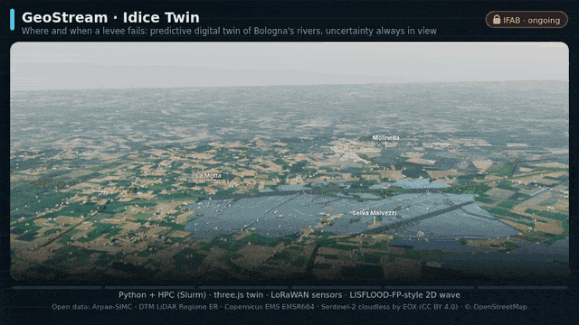
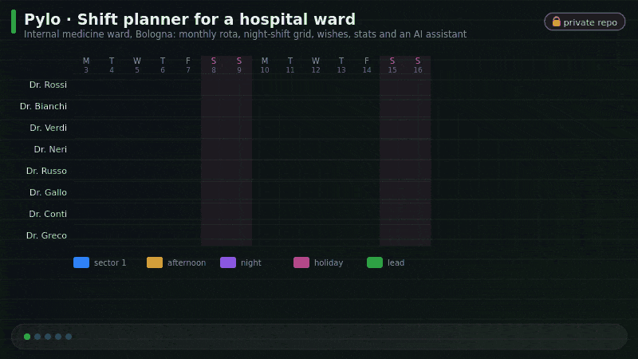

### Hi there, I'm Benedetta 👋

🎓 **Research**: structural health monitoring — guided waves, acoustic emission, uncertainty-aware machine learning (PhD, University of Bologna).

🏛️ **Work**: [IFAB Foundation](https://www.ifabfoundation.org), Bologna — digital twins, datalakes, IoT and AI for health and territory.

🛠️ **I like building**: tools that turn messy data into something people can actually use, from HPC pipelines to small offline desktop apps.

> Most of my work lives in **private repositories** (research code, institutional projects). The animations below summarise what's inside.

---

## 🔭 Selected projects

<table>
<tr>
<td width="50%"></td>
<td width="50%">

### 🌊 GeoStream · Idice Twin
**Where and when does a levee fail?** A predictive digital twin of the Idice river (Bologna), built after the May 2023 floods: failure probability for each levee reach, with the uncertainty always visible.

- Terrain from the regional LiDAR DTM; 20 years of Arpae open data
- 2D flood wave (LISFLOOD-FP-style) replayed on the terrain and compared with Copernicus EMS
- Low-power sensor node: piezometers, soil moisture, LoRaWAN, solar
- Browser twin in three.js; calibration on HPC with Slurm

`Python` `HPC/Slurm` `three.js` `LoRaWAN` `Blender` · 🔒 IFAB, ongoing

</td>
</tr>
<tr>
<td width="50%">

### 🧠 AIND · Neurodegeneration Datalake
Data-driven prevention of **Parkinson's and Alzheimer's disease**: a datalake that collects, cleans and catalogues clinical data (ADNI and others), the foundation for personalised AI risk models.

- Automatic download and cleaning pipeline (ATN profile, cut-offs, normalisation)
- MinIO object storage + MongoDB metadata catalogue, compute nodes via Slurm
- Python client (`dl_client`) for metadata upload, querying and running jobs

`Python` `MongoDB` `MinIO` `Slurm` `pandas` · 🔒 private

</td>
<td width="50%"></td>
</tr>
<tr>
<td width="50%"></td>
<td width="50%">

### 🫧 ADAPT-AI · Synthetic biodigester
**Foam detection in a biogas digester.** Real sensors (OpenMV AE3 camera + Time-of-Flight) and a **synthetic twin rendered in Blender**, used to train a CNN.

- 3 foam classes × 3 camera heights, randomised scenes
- Every frame: RGB, ToF depth, 12×12 ToF zones and segmentation masks
- Fully automated Slurm chain on the PANDORA cluster (generation → masks → analysis → upload)

`Blender` `Python` `Slurm` `PyTorch` `OpenMV` · 🔒 private

</td>
</tr>
<tr>
<td width="50%">

### 📈 AG-CWT · Acoustic-emission localisation
Code for my paper on **onset picking as temporal edge detection on the CWT scalogram**, plus probabilistic source localisation.

- AG-CWT picker: scale-averaged envelope gate + signed-gradient onset, CFAR threshold
- One Gaussian process per sensor pair models the TDoA → posterior map, MAP estimate and HPD regions
- Nested cross-validation against 12 benchmarks on aluminium and CFRP plates

`Python` `NumPy/SciPy` `Gaussian Processes` `CWT` · 🔒 private (paper in preparation)

</td>
<td width="50%"></td>
</tr>
<tr>
<td width="50%"></td>
<td width="50%">

### 🦠 Pylo · Hospital shift planner
Rota planning for a **hospital internal medicine ward**: daily shifts like the ward's own sheet, night-shift grid, leave and wishes, automatic checks and per-doctor statistics.

- Generator that respects the ward's rules (rest after nights, limits, exclusions)
- **Pylo**, the assistant (Ollama or Claude): shift swaps in plain language, even from attachments
- Excel import/export; desktop builds for Windows, macOS and Linux

`Python` `JavaScript` `Ollama` `Claude API` `PyInstaller` · 🔒 private *(names in the animation are invented)*

</td>
</tr>
<tr>
<td width="50%">

### 🏦 Gringott · Personal finance vault
An **offline, encrypted** desktop app for investments, expenses and pension fund, explained in plain language, with **Edvige**, an owl assistant running locally.

- What-if simulator, savings goals, pension-fund tax calculator, tax-return summary
- Real costs per product, rebalancing alerts, PDF/CSV statement import
- AES encryption (PBKDF2), local LLM via Ollama: no data leaves the PC

`Python` `JavaScript` `Chart.js` `Ollama` · ✅ [public repo](https://github.com/bbaldini/gringott) *(demo data in the animation)*

</td>
<td width="50%"></td>
</tr>
</table>

### 🧰 Also
- **Revelio**: a personal, local research radar (FastAPI + Ollama) · 🔒
- **Passaporta**: shared Gantt, wiki and vault for a team, local-first and federated · 🔒
- **lamb-wave-surrogate**: surrogate model for guided-wave defect localisation · 🔒
- **[ding-claude](https://github.com/bbaldini/ding-claude)**: it tells you when Claude has finished its task · ✅

---

### 🐱 GitHub stats

GeoStream imagery: DTM LiDAR Regione Emilia-Romagna · Copernicus EMS EMSR664 (© European Union) · Sentinel-2 cloudless by EOX IT Services (CC BY 4.0, modified Copernicus data) · © OpenStreetMap contributors (ODbL) · Arpae-SIMC open data (CC BY 4.0). Animations generated from the projects' own figures and code.
