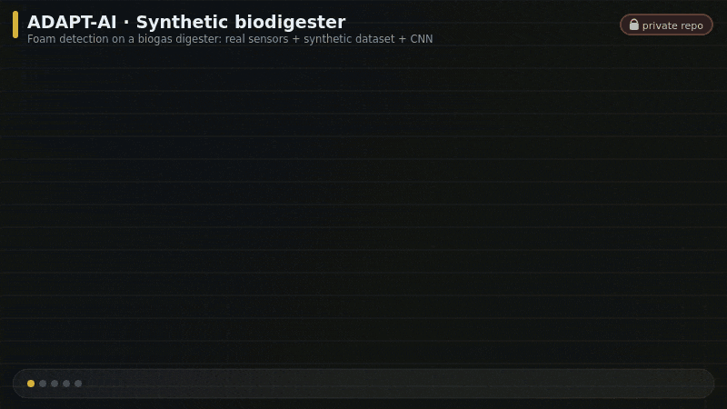
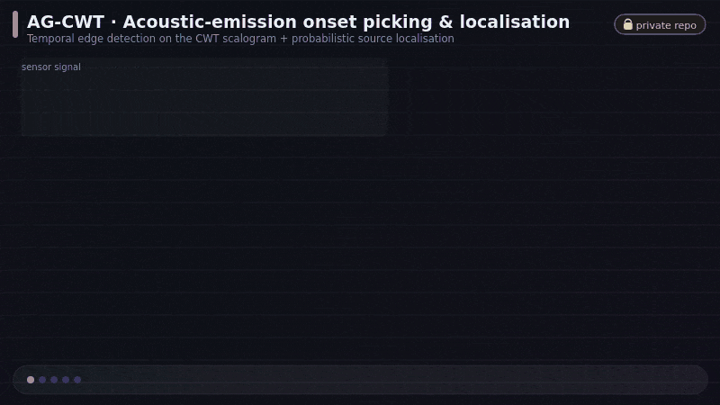
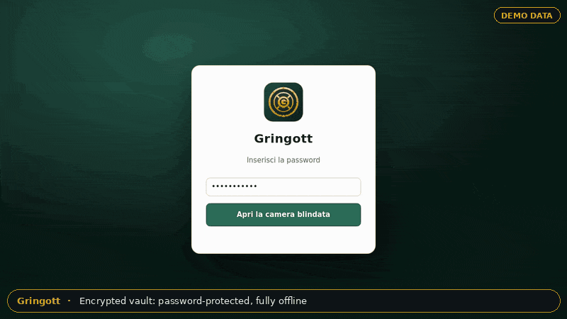

### Hi there, I'm Benedetta 👋

🎓 **Research**: structural health monitoring — guided waves, acoustic emission, uncertainty-aware machine learning (PhD, University of Bologna).

🏛️ **Work**: [IFAB Foundation](https://www.ifabfoundation.org), Bologna — digital twins, data platforms, IoT and AI.

> Most of my work lives in private repositories. The animations below give a quick idea of what's inside.

---

## 🔭 Selected projects

<table>
<tr>
<td width="50%"></td>
<td width="50%">

### 🌊 GeoStream
A predictive digital twin for rivers, levees and slopes.

`Python` `HPC` `three.js` `LoRaWAN` · 🔒 ongoing

</td>
</tr>
<tr>
<td width="50%">

### 🧠 AIND · Health datalake
Early prediction of Alzheimer's disease on a secure health data platform.

`Python` `MongoDB` `MinIO` `Slurm` · 🔒 private

</td>
<td width="50%"></td>
</tr>
<tr>
<td width="50%"></td>
<td width="50%">

### 🫧 ADAPT-AI · Synthetic biodigester
Foam detection in a biogas digester, with a synthetic twin for training.

`Blender` `Python` `PyTorch` `HPC` · 🔒 private

</td>
</tr>
<tr>
<td width="50%">

### 📈 AG-CWT
Acoustic-emission analysis and source localisation.

`Python` · 🔒 paper in preparation

</td>
<td width="50%"></td>
</tr>
<tr>
<td width="50%"></td>
<td width="50%">

### 🔮 Revelio
A personal, local research radar.

`FastAPI` `Ollama` `SQLite` · 🔒 private

</td>
</tr>
<tr>
<td width="50%">

### 🧭 Passaporta
A shared Gantt, wiki and vault for a team.

`Python` `JavaScript` `TLS` · 🔒 private

</td>
<td width="50%"></td>
</tr>
<tr>
<td width="50%"></td>
<td width="50%">

### 🦠 Pylo
A shift planner for a hospital ward.

`Python` `JavaScript` `Ollama` `Claude` · 🔒 private

</td>
</tr>
<tr>
<td width="50%">

### 🏦 Gringott
An offline personal-finance app with a local assistant.

`Python` `JavaScript` `Ollama` · 🔒 private

</td>
<td width="50%"></td>
</tr>
</table>

### 🧰 Also
- **lamb-wave-surrogate**: guided-wave surrogate model · 🔒
- **[ding-claude](https://github.com/bbaldini/ding-claude)**: it tells you when Claude has finished its task · ✅

Names and data shown in the demo animations are invented.

© 2026 Benedetta Baldini. All rights reserved. Text, images and animations may not be reused without permission.
